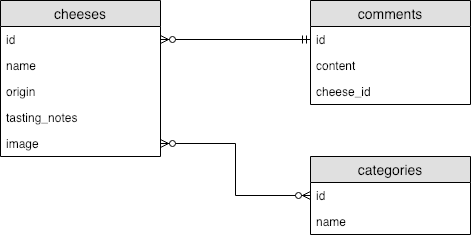

<h1>
  FastAPI SQLAlchemy Relationships
  Concepts
</h1>

**Learning objective:** By the end of this lesson, you will be able to **differentiate** One-to-Many and Many-To-Many data relations.

## Overview

Creating relationships between models is vital for any application. The relationships between models is organizes and defines the connections between data in different tables within our application. By defining relationships it becomes easier to perform complex queries and operations.

Let's look at how we can do define model relations with SQLAlchemy. Here's an example diagram below, that shows some relationships between different entities in a database.

We're using cheeses here to mix things up!

 

This a called an Entity Relationship Diagram (ERD). The symbols at the ends of the lines represent the kinds of relationships these 3 tables have with each other. The lines that join data the lines that join data entities are known as “lines of cardinality.”entities are known as “lines of cardinality.”

The 3-line symbol that looks like a crow's foot means 'Many', and the 2 parallel double line symbol means 'One'.

So here we have two types of relationships:

- One-To-Many (1:M) between Cheeses and Comments because one cheese can have many comments
- Many-to-Many (M:M) between Cheese and Categories because a category can have many cheeses, and a cheese can have many categories.

We'll be focusing on the 1:M relationship in our app, as this is more common and slightly more straightforward in FastAPI.

## One-to-many (1:M) relationship

Let's apply this database modeling principle to our teas.

Let's start with exploring the relationship between teas and comments:

- A tea can have **many** comments
- A comment belongs to **one** tea

Let's take a moment to further break down the entity relationship between `comments` and a `teas` in our database.

1. `One` tea can have `many` comments

For each tea in the database, there can be multiple related comments. For example, if you have a tea called "Green Tea," there might be several comments from different users describing their opinions or experiences with this tea.

1. A comment `belongs` to `one` tea

By `belongs` we will ensure that each comment in the database is stores a reference to only one specific tea.

For example, a comment saying "This tea is very refreshing," it must be associated with one particular tea, like "Green Tea" or "Black Tea," but not both. Since a comment `belongs` to a tea, we will define this relationship to ensure that a `comment` cannot exist in the database without an associated tea.
